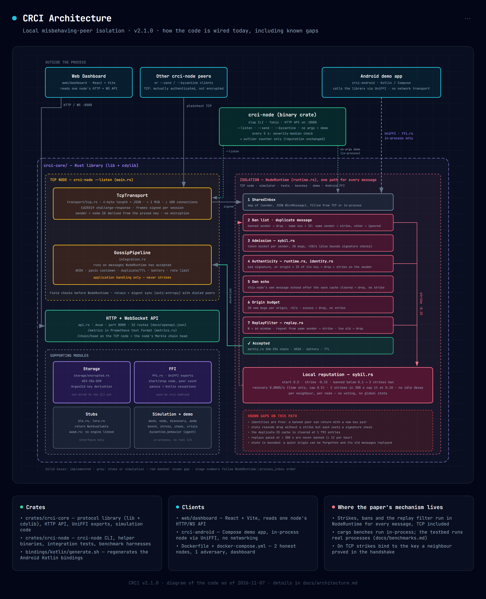

# CRCI — Crisis Response Communication Infrastructure

[](https://github.com/medwinjose/crci/actions/workflows/ci.yml) [](https://opensource.org/licenses/Apache-2.0) [](https://www.rust-lang.org/) [](https://doi.org/10.5281/zenodo.23033990)

**A peer-to-peer mesh protocol, written in Rust, in which every node detects and isolates misbehaving
neighbours on its own — no central server, no voting rounds, no global consensus.**

---

## The Problem

When a disaster strikes, cellular towers and internet links are often the first things to fail, at the
moment coordination matters most. Ad-hoc mesh networks of phones and radios can restore reachability,
but an open mesh has no gatekeeper. Any participant can replay old alerts to trigger false alarms,
forward tampered messages, or flood its neighbours.

The classical answer, Byzantine fault-tolerant consensus such as PBFT, assumes a stable, known membership
and exchanges O(n²) messages per agreement round. Neither assumption holds on intermittently connected,
low-bandwidth links (LoRa runs at a few kbit/s), where nodes join, leave and partition constantly.

## The Solution

CRCI moves misbehaviour isolation **into the gossip layer itself** and makes it **purely local**:

- **Every message is signed.** Each node has an Ed25519 identity; messages carry the author's public key,
  a signature and a sequence number.
- **Each node keeps its own reputation score for each neighbour.** Only violations a receiver can verify
  by itself count against a neighbour: replaying a message it already sent or forwarding an invalid
  signature. On TCP a neighbour is identified by the key it proves in a challenge-response handshake, so
  one peer cannot get another struck by claiming its ID.
- **Three strikes isolate.** A neighbour starts at 0.5 and loses 0.15 per strike; below 0.1 it is banned
  locally. The same message arriving through a *different* neighbour is ordinary gossip redundancy and is
  never penalised.
- **Reordering is tolerated.** A sliding-window replay filter (W = 64) accepts late packets inside the
  window; packets older than the window are dropped without a strike, since an honest neighbour can
  deliver old messages after a partition.
- **Partitions heal without penalties.** After a partition a node asks its neighbours for what it missed
  with a signed digest; their answers never count against them, while unsolicited repeats still do.
- **No coordination.** No voting, no membership protocol, no global state: dissemination stays O(n) per
  message, and every node keeps working while partitioned.

| Design decision | Instead of | Why | Record |
|---|---|---|---|
| Local reputation and isolation | PBFT-style consensus | No membership requirement; O(n) instead of O(n²) traffic | [ADR 002](docs/adr/002-reputation-over-pbft.md) |
| Custom transport behind a `Transport` trait | A general-purpose P2P framework | Small, auditable networking layer; other media (BLE, LoRa) plug in behind the same trait | [ADR 001](docs/adr/001-custom-tcp-transport.md) |
| Hash-chained local state | CRDTs | Ordered, tamper-evident record of what a node has seen | [ADR 003](docs/adr/003-merkle-over-crdt.md) |

## Architecture



Interactive version: [docs/architecture/crci-architecture.html](docs/architecture/crci-architecture.html) ·
written description: [docs/architecture.md](docs/architecture.md).

Every incoming message, in-process or over TCP, passes through the same local pipeline in `NodeRuntime`:

```
ban list → duplicate check per neighbour → token bucket → Ed25519 verification
  → author-key pinning → per-origin budget → replay filter → accept
                 └──── each verifiable violation: −0.15 reputation for the sending neighbour ────┘
```

## Results

From the accompanying preprint ([doi.org/10.5281/zenodo.23032042](https://doi.org/10.5281/zenodo.23032042)),
measured with the in-process benchmark harness, 50 deterministic trials per condition:

| Condition | Strikes to isolation | Isolation time (mean) | Honest peer isolated |
|---|---|---|---|
| Replay attack, no delay | 3 | < 1 ms | 0 / 50 |
| Replay attack, 15 ms between replays | 3 | 45.8 ms | 0 / 50 |

- **Reordering:** late or stale packets never count against a neighbour; packets more than W behind
  are dropped instead of delivered.
- **Paced replays:** reputation recovers with elapsed time only (one strike forgiven per 300 s, never
  above the initial score) and two strikes within 300 s damp recovery. In a 6-hour simulated sweep an
  adversary replaying more often than every 300 s is banned; one pacing at 300 s or slower is never banned
  but gets at most 12 replays per hour past admission, each detected and dropped. Proved for any network
  size: no identity that stays unbanned takes more than 14 strikes in any hour, three strikes within 100 s
  always ban, and a ban lasts 300–500 s ([analytical bounds](docs/formal-verification.md#analytical-bounds)).
  Before this change, an adversary replaying every 20 s was never banned.

**Emulation testbed** (real `crci-node` processes over TCP in Linux network namespaces with `tc netem`,
emulated on one host; three seeds per configuration, every run within the testbed's fidelity checks):

| Setting | Result |
|---|---|
| 20–500 nodes, random geometric and 4-regular topologies, a relay replaying every message | Banned by all its neighbours in every run (≈ 2 s at 1 msg/s); 0 honest nodes banned; every honest message delivered after the ban, also to nodes that relied on the evicted relay |
| Packet loss 0–20 %, delay 40 ± 15 ms, reordering up to 15 % (162 runs) | 0 honest nodes banned at any loss level; median eviction 2.0–2.2 s; with 60 s to recover, every message reached every honest node at 20 % loss (after the ban, current build, two sets: p99 3.6 and 5.5 s, worst 20.1 s; the p99 lies between 3 and 9 s over [eight sets](docs/benchmarks.md#the-latency-tail-at-20--loss-over-repeat-sets)) |
| A replayer that keeps its rate budget empty | Banned in ≈ 12 ms (before: never banned, honest delivery 32–49 %) |
| A node flooding fresh, validly signed messages at 40 msg/s | Honest delivery 100 % (before the per-origin budget: 82–98 %) |
| Offered load | No honest message dropped at 16 msg/s network-wide; one node can sustain at most 5 msg/s |
| 20 % or 50 % of the links going down and up every 5–10 s, with and without a replayer (102 runs) | 0 honest nodes banned or struck; every message delivered to every node; the replayer banned by all neighbours within 7.6 s |
| 10–45 % of the nodes replaying, N = 20/50/100 (90 runs) | Every honest neighbour of every replayer bans it (3 958 of 3 958), median ≈ 2 s, 0 honest nodes banned; honest delivery inside the connected part 100 %. Removing up to 45 % of the nodes can cut honest nodes off: 27 of 72 runs, see the [partition probabilities](docs/benchmarks.md#share-of-replaying-nodes) |

Every number above links back to a raw data file and the exact command in
[docs/benchmarks.md](docs/benchmarks.md). Four summary figures, each marked emulation or simulation, are in
[docs/figures](docs/figures) ([how they are made](docs/benchmarks.md#figures)).

## Engineering

- **Rust workspace:** `crci-core` (protocol library, also built as a shared library) and `crci-node`
  (CLI node, integration tests, benchmark harnesses).
- **Security:** Ed25519 signatures (`ed25519-dalek`), AES-256-GCM encrypted local storage with an
  Argon2id-derived key, per-neighbour rate limiting.
- **Interfaces:** HTTP + WebSocket API ([OpenAPI](docs/openapi.json)), Prometheus metrics, a React
  dashboard, and an Android app that calls the Rust core directly through UniFFI-generated Kotlin bindings.
- **Verification:** unit and integration test suite, property-based tests (proptest) showing that honest
  reordering within the replay window never costs a relay reputation or loses a message, TLA+ models of the isolation protocol, exhaustively model-checked on small instances for safety and delivery and tied to the code by replaying TLC's transitions and behaviours through the real runtime,
  analytical bounds on the reputation and strike rules with written proofs, each reputation bound also checked against the code
  ([docs/formal-verification.md](docs/formal-verification.md)), and a Linux network-namespace test with
  `tc netem` delay and loss in CI.
- **CI:** formatting, Clippy with warnings denied, the full test suite on Ubuntu and Windows,
  cross-compilation for ARMv7 and AArch64 (Raspberry Pi), a documentation check, and model checking of the
  TLA+ specifications (the quick configurations) with a check that the replayed exports are current.

## Quick start

Requires a stable Rust toolchain.

```bash
git clone https://github.com/medwinjose/crci.git
cd crci
cargo build --workspace
cargo test --workspace
```

Run a node (HTTP API on port 8080), then send it a message from a second terminal:

```bash
cargo run -p crci-node --bin crci-node -- --listen 127.0.0.1:7001 --node-id node-a
cargo run -p crci-node --bin crci-node -- --send "hello" --to 127.0.0.1:7001 --node-id node-b
```

Reproduce the benchmarks:

```bash
cargo bench -p crci-node --bench byzantine_bench
cargo bench -p crci-node --bench ablation_bench
cargo bench -p crci-node --bench recovery_bench
```

Re-run every model-checking configuration (needs Java 11+; about 85 min on 12 cores):

```bash
make tla
```

A Docker Compose demo (two honest nodes, one adversarial node, and the dashboard) is in
`docker-compose.yml`; see [scripts/README.md](scripts/README.md).

## Research status and roadmap

CRCI is an active research project. The isolation pipeline runs in the node runtime used by both the
networked TCP node and the test suite. Done: a network-emulation testbed of real processes (20–500
nodes, loss, delay, jitter, reordering, attacker variants, invalid-signature floods, link flapping, defence baselines and ablations, and a sweep of the share of replaying nodes up to 45 %) and an in-process simulation of up to 5 000
nodes, cross-checked against the testbed ([results](docs/benchmarks.md#in-process-simulation-up-to-5-000-nodes)).
Current work, in order:

1. Origin IDs derived from public keys, so an ID cannot be claimed before its owner.

Out of scope: large-scale Sybil attacks, colluding adversaries, and physical LoRa/BLE radios (the BLE and
LoRa transports are interface stubs). Known gaps are tracked in [docs/threat-model.md](docs/threat-model.md).

## Repository layout

| Path | Contents |
|---|---|
| `crates/crci-core` | Protocol library: runtime, reputation, replay filter, cryptography, storage, transports, API |
| `crates/crci-node` | CLI node, integration tests, benchmark harnesses |
| `crci-android` | Android app using the Rust core through UniFFI |
| `web/dashboard` | React dashboard for a node's HTTP API |
| `docs` | Architecture, threat model, benchmarks, ADRs, TLA+ model, raw evidence ([index](docs/README.md)) |
| `scripts` | Demo, build and documentation-check scripts |

## Paper and citation

**CRCI: Local Reputation-Based Fault Isolation for Ad-Hoc Gossip Communication** — Medwin Jose,
Vellore Institute of Technology, Bhopal.

- Preprint: [doi.org/10.5281/zenodo.23032042](https://doi.org/10.5281/zenodo.23032042)
- Software archive (all versions): [doi.org/10.5281/zenodo.23033990](https://doi.org/10.5281/zenodo.23033990)

Citation metadata is in [CITATION.cff](CITATION.cff).

## License

Apache License 2.0. See [LICENSE](LICENSE).
