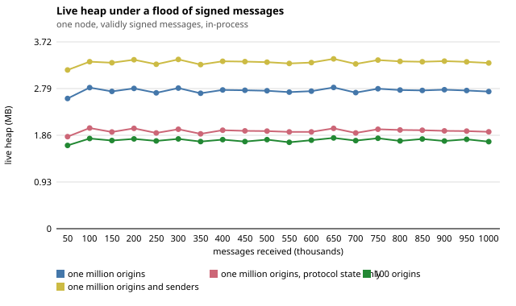

# Benchmarks

Every number below comes from a recorded run. Each entry names the harness, the exact command, and the
raw output file. Anything without a recorded run is listed under [Not measured](#not-measured).

## How the benchmarks run (read this first)

The three cargo benchmarks drive `NodeRuntime` **in-process** (the emulation testbed below runs real processes). A test writes JSON-encoded `WireMessage`
bytes into a shared `HashMap` inbox and calls `NodeRuntime::process_inbox()` directly. There are no
sockets, no TCP, no second process and no network stack. Latencies are therefore processing time plus any
`std::thread::sleep` the harness inserts, measured with `Instant::elapsed().as_millis()` (whole
milliseconds, truncated).

Two harness details affect what the results mean:

- The harnesses register **one honest peer that sends a single message** per trial. "Honest survival"
  means that peer is not banned after that message.
- The recorded runs of `recovery_bench` and `ablation_bench` below reset a per-origin signature-check
  counter between messages, because `NodeRuntime` then dropped every message from an origin after its 5th
  signature check. That counter has been removed (signature checks are now bounded by the per-sender token
  bucket) and the harnesses no longer reset anything.
- The per-sender token bucket (20 messages, then a refill per second) applies in every harness. The
  in-process results below were recorded with a refill of 5 per second and before the per-origin budget
  (20 messages, then 5 per second per origin); the defaults are now 20 per second per neighbour plus the
  per-origin budget (see the emulation testbed section).
- `recovery_bench` runs on a simulated clock (`SybilGuard::use_manual_clock` and `advance_time`), so it
  covers six hours per condition in seconds and produces byte-identical output on every run.

Bench targets have `test = false`, so `cargo test` never runs them or rewrites their CSVs.

## Figures

Four figures summarise the evaluation; `python3 scripts/figures/make_figures.py` (standard library only,
`make figures`) draws them as SVG into [`docs/figures/`](figures/) from data committed in this repository,
and fails if a run count behind a point is not the one stated. Each figure says in its subtitle whether it
is **emulation** (real processes on one host) or **simulation**; error bars are the sample standard
deviation over the runs behind a point.

| Figure | Shows | Kind | Data |
|---|---|---|---|
| [`fig-a-latency-vs-n.svg`](figures/fig-a-latency-vs-n.svg) | p95 delivery latency after the quarantine against N, 0 / 10 / 30 % of the nodes replaying, rgg and mesh; 3 seeds per point | emulation | [`evidence/ratio-2026-11-07/ratio.csv`](evidence/ratio-2026-11-07/ratio.csv) |
| [`fig-b-paced-attack.svg`](figures/fig-b-paced-attack.svg) | Reputation of a paced replayer over six hours, replay every 120, 290 and 330 s; deterministic, no error bars | simulation | `crates/crci-node/benches/results/recovery_trajectory.csv` |
| [`fig-c-survivability-vs-loss.svg`](figures/fig-c-survivability-vs-loss.svg) | Delivery after the ban and honest nodes not banned against packet loss 0–20 %; 18 runs per point | emulation | [`evidence/testbed-fast-recovery-2026-11-04/netem/results.csv`](evidence/testbed-fast-recovery-2026-11-04/netem/results.csv) |
| [`fig-d-goodput-vs-baselines.svg`](figures/fig-d-goodput-vs-baselines.svg) | Honest deliveries per second under replay and flood attacks for `full`, `static-bucket` and `vanilla`; rgg N = 50, 3 seeds per point (vanilla at 200 messages/s omitted: three runs exceed the host-CPU limit) | emulation | [`evidence/ablation-2026-11-06/testbed/baselines.csv`](evidence/ablation-2026-11-06/testbed/baselines.csv) |

The emulation figures come from two node builds (`04ec7be5` for figure c, `aa619cb0` for figures a and d), as
the sections above say; planned: regenerate all of them on one final build before submission.

Two protocol fixes came after every testbed set on this page: messages are keyed by signing key and ID, and one
gossip copy that follows its sync answer is excused ([model checking](formal-verification.md)). On the node build
with both, one small set has been run: the netem conditions at N = 20, seed 1, rgg and mesh, 18 runs. All were
faithful, no honest node was banned, delivery after the ban was 1.0 and all of the attacker's neighbours banned it
([`smoke-results.csv`](evidence/tla-2026-11-07/smoke-results.csv)). That is a check, not a re-measurement: the larger
sets have not been repeated on that build.

## Byzantine eviction, in-process

The preprint no longer prints this table; the emulation figures above replace it. It stays here as the
description of the in-process harness.

- **Harness:** `crates/crci-node/benches/byzantine_bench.rs`
- **Command:** `cargo bench -p crci-node --bench byzantine_bench` (writes to `crates/crci-node/benches/results/`)
- **Procedure per trial:** honest peer `node-h` sends one signed message; adversary `node-b` sends one
  signed message and then replays it 3 times. Each replay is a duplicate message ID from the same
  sender, which costs −0.15 reputation: 0.5 → 0.35 → 0.2 → 0.05 < 0.1 = banned. The timer starts before
  the first replay and stops after the third. The "15 ms delay" condition sleeps 15 ms before each replay.
- **Raw data:** `byzantine_eviction_baseline.csv`, `byzantine_eviction_jitter.csv`

| Condition | Trials | Strikes to ban | Eviction time, mean (min / max) | Adversary banned and honest peer not banned |
|---|---|---|---|---|
| No delay | 50 | 3 | 0.00 ms (0 / 0) | 50 / 50 |
| 15 ms sleep before each replay | 50 | 3 | 45.82 ms (45 / 46) | 50 / 50 |

The procedure is deterministic, so 50 trials show the harness is consistent, not statistical spread. The
45.82 ms is almost entirely the 3 × 15 ms of sleep.

## Sliding window vs. reorder depth (preprint Table IV)

- **Harness (of the recorded run):** `crates/crci-node/benches/ablation_bench.rs`, since rewritten (see
  [Replay window W](#replay-window-w))
- **Command (recorded run):** `cargo bench -p crci-node --bench ablation_bench --features paper_v2`
  (the `paper_v2` feature has since been removed; the sliding window is now always on)
- **Procedure:** for W ∈ {8, 16, 32, 64} and reorder depth D ∈ {1, 2, 4, 8, 16, 32}, the honest peer
  sends 3 pairs of packets: first sequence s + D, then the delayed sequence s. The cell reads
  "false-positive ban" if the honest peer ends up banned. In the default build `window_size` is ignored
  (strict-monotonic check); the `paper_v2` feature enables the window.
- **Raw output:** [`evidence/paper-v1-benches-2026-09-25/ablation_paper_v2_0237.txt`](evidence/paper-v1-benches-2026-09-25/ablation_paper_v2_0237.txt)

| D | W = 8 | W = 16 | W = 32 | W = 64 |
|---|---|---|---|---|
| 1, 2, 4, 8 | survival | survival | survival | survival |
| 16 | false-positive ban | survival | survival | survival |
| 32 | false-positive ban | false-positive ban | survival | survival |

**Strict-monotonic column:** the preprint's Table IV also shows a "Strict-Monotonic (W = 0)" column with a
false-positive ban in every row. The only recorded strict-monotonic runs (default build,
[`ablation_default-build_run1_0235.txt`](evidence/paper-v1-benches-2026-09-25/ablation_default-build_run1_0235.txt)
and `_run2_0235.txt`) report **survival in every cell**. That column is not supported by any recorded run;
it was re-measured as delivered messages (below).

**Current rule:** the recorded runs above predate the stale-packet rule. Today a packet more than W behind
is dropped without a strike, so reordering can no longer ban an honest peer at any W, and this harness
shows survival in every cell by construction. What W now controls is delivery: packets beyond the window
are lost. The window ablation was re-measured as delivered messages, W = 0 to 128 and reorder depth 0 to 64, in
[Replay window W](#replay-window-w): W = 0 delivers 50 % of an origin's messages at depth 1 and strikes nobody.

## Paced attack vs. reputation recovery

- **Harness:** `crates/crci-node/benches/recovery_bench.rs`
- **Command:** `cargo bench -p crci-node --bench recovery_bench`
- **Procedure:** one receiver, one adversarial transport peer that authors its own messages. The adversary
  sends a fresh, validly signed message every 10 s and, every *P* seconds, resends its latest message
  unchanged (an exact duplicate from the same peer inside the window: one strike). Simulated clock, 6 h
  (21 600 s) per period, one step per simulated second.
- **Raw data:** [`recovery_paced_sweep.csv`](../crates/crci-node/benches/results/recovery_paced_sweep.csv)
  (one row per *P*), [`recovery_trajectory.csv`](../crates/crci-node/benches/results/recovery_trajectory.csv)
  (score every 10 s for *P* = 120, 290, 330 s); console summary in
  [`evidence/paced-attack-2026-11-02/`](evidence/paced-attack-2026-11-02/). Two runs gave byte-identical CSVs.

| Replay period *P* (s) | Strikes landed in 6 h | First ban (s) | Time banned |
|---|---|---|---|
| 1 | 89 | 3 | 99.6 % |
| 15 | 85 | 45 | 95.2 % |
| 60 | 74 | 180 | 82.9 % |
| 120 | 74 | 480 | 75.3 % |
| 240 | 73 | 1 680 | 26.8 % |
| 290 | 72 | 10 150 | 2.9 % |
| 300 | 72 | never | 0 % |
| 600 | 36 | never | 0 % |
| 1 200 | 18 | never | 0 % |

The measured threshold is the forgiveness period, *T* = penalty / recovery rate = 0.15 / 0.0005 = 300 s:
an adversary pacing at *P* ≥ 300 s is never banned and gets at most 12 replays per hour past admission; below it the
adversary is banned, sooner the faster it replays. Strike damping does not move this threshold; it halves
the time a sub-threshold adversary survives (net change per period 0.001 *P* − 0.3 instead of
0.0005 *P* − 0.15). An adversary that keeps replaying through bans (*P* = 1 s) gets about 15 replays per
hour past admission across ban cycles while being banned 99.6 % of the time. Every replay is dropped and costs one
signature check.

**Before this rule** (same commit lineage, previous recovery rules; real-time run, adversary sending valid
traffic at 4 messages per second; harness and output in
[`evidence/paced-attack-2026-11-02/`](evidence/paced-attack-2026-11-02/)): an adversary replaying every
20 s or 30 s was never banned and its score rose to 0.85 after 8 replays; every 10 s its score fell by
0.03 per replay; every 5 s it was banned after 5 replays. Recovery then grew with the adversary's own
traffic (+0.005·√Δt per admitted message), so sending more valid messages bought faster forgiveness.

The 2026-09-25 runs (`recovery_paper_v2_*` in
[`evidence/paper-v1-benches-2026-09-25/`](evidence/paper-v1-benches-2026-09-25/)) measured a different
harness (fresh messages with an older sequence number, which the current rules drop without a strike) and
are kept as history only.

## Ed25519 cost

- **Harness:** `crates/crci-node/benches/crypto_bench.rs` (criterion, 100 samples per case; signing and
  verification go through `WireMessage::sign_with` / `verify_signature`, i.e. `verify_strict` on the
  canonical signed bytes)
- **Command:** `cargo bench -p crci-node --bench crypto_bench`
- **Recorded run (2026-11-02, Intel i5-12450HX, Windows 11, one thread):** keygen 13.4 µs, sign 15.2 µs,
  verify 37.0 µs for a valid and 36.9 µs for an invalid signature (about 27 000 verifications per second per
  core), canonical encoding 44 ns. Criterion's console output is not committed; the numbers are for this
  CPU only.

## Emulation testbed (real processes, one host)

- **Harness:** `scripts/testbed/` (see its [README](../scripts/testbed/README.md)): one `crci-node` process
  per Linux network namespace, one veth link each to a shared bridge, `tc netem` 10 ms one-way delay per
  hop (20 ms round trip), the overlay topology given with `--peers`. Emulated on one host (WSL2 on an
  Intel i5-12450HX, 12 logical CPUs, 7.6 GiB), not on separate machines or radios.
- **Command:** `make testbed OUT=…` (= `sudo scripts/testbed/run_all.sh OUT target/release/crci-node`),
  `make netem OUT=…` and `make attacks OUT=…`. One build for every run below (SHA-256 in the evidence
  folder).
- **Each run:** a 60 s window, seeds 1–3 for every configuration (the seed selects the topology instance,
  the roles and the traffic schedule). Traffic 1 signed message/s in total unless stated (0.5/s from a
  source S, 0.5/s spread over the other nodes). A relay B whose removal keeps the graph connected, chosen to
  maximise the set D of nodes whose every shortest path from S runs through B, repeats every message once
  from 20 s on. Fidelity criteria, fixed before the runs (all must hold): every node listening at the
  start, mean host CPU below 70 %, no swap activity, no kernel input-backlog drops, ICMP RTT on 10 sampled
  overlay links with median within 10 % and 95th percentile within 25 % of the configured round trip.
  **All 240 runs below (48 here, 162 with impairments, 30 attacker and recovery runs) met all of
  them.** Pass criteria for each experiment were written down before its runs (`criteria.txt` in the
  evidence folder).
- **Recorded runs (2026-11-04):** [`evidence/testbed-fast-recovery-2026-11-04/`](evidence/testbed-fast-recovery-2026-11-04/).
  Superseded: [`evidence/testbed-final-2026-11-03/`](evidence/testbed-final-2026-11-03/) (the build before
  frames lost with an aborted connection were recovered quickly; every configuration re-run since),
  [`evidence/testbed-2026-11-02/`](evidence/testbed-2026-11-02/) and
  [`evidence/netem-2026-11-02/`](evidence/netem-2026-11-02/) (earlier protocol, kept for the record).

Each row covers three seeds; a range is the lowest and highest of the three.

| Run | N | Seeds | Mean degree, diameter | Faithful | Delivery after eviction (min) | Latency median / p95 after eviction | B banned by all neighbours | Eviction latency (median) | Honest false evictions | Honest frames rate-limited | Hop excess (median) | Host CPU mean / max | RSS per node |
|---|---|---|---|---|---|---|---|---|---|---|---|---|---|
| rgg-20 | 20 | 3 | 3.7–4.6, 6–10 | 3/3 | 100% | 33–53 / 66–108 ms | 3/3 | 2002–2012 ms | 0 | 0 | 1.0 ms | 0.3–0.4 / 1.5–2.1 % | 6.6–6.7 MiB |
| rgg-50 | 50 | 3 | 6.0–6.9, 8–10 | 3/3 | 100% | 43–63 / 75–89 ms | 3/3 | 1999–2023 ms | 0 | 0 | 0.9–1.0 ms | 0.8–1.0 / 3.5–4.1 % | 6.9 MiB |
| rgg-100 | 100 | 3 | 7.1–8.0, 10–12 | 3/3 | 100% | 47–66 / 87–119 ms | 3/3 | 1990–2010 ms | 0 | 0 | 1.0 ms | 1.8–1.9 / 7.9–8.6 % | 6.9–7.0 MiB |
| mesh-20 | 20 | 3 | 4.0, 4 | 3/3 | 100% | 22–23 / 42–44 ms | 3/3 | 2001–2019 ms | 0 | 0 | 1.0 ms | 0.3–0.4 / 1.4–3.6 % | 6.6–6.7 MiB |
| mesh-50 | 50 | 3 | 4.0, 5 | 3/3 | 100% | 33 / 52–54 ms | 3/3 | 2011–2013 ms | 0 | 0 | 1.0 ms | 0.7 / 2.5–3.1 % | 6.7 MiB |
| mesh-100 | 100 | 3 | 4.0, 6 | 3/3 | 100% | 43–44 / 57–58 ms | 3/3 | 2010–2011 ms | 0 | 0 | 1.0 ms | 1.1–1.6 / 5.1–9.8 % | 6.7 MiB |
| sweep-rgg-200 | 200 | 3 | 8.9–9.5, 14 | 3/3 | 100% | 58–75 / 102–123 ms | 3/3 | 2010–2014 ms | 0 | 0 | 1.2–1.7 ms | 4.3–4.7 / 17.4–18.1 % | 7.0–7.1 MiB |
| sweep-rgg-300 | 300 | 3 | 9.7–10.6, 16–17 | 3/3 | 100% | 74–84 / 129–150 ms | 3/3 | 1997–2015 ms | 0 | 0 | 1.6–1.9 ms | 6.8–7.7 / 27.7–32.1 % | 7.2–7.3 MiB |
| sweep-rgg-500 | 500 | 3 | 11.1–11.4, 19–21 | 3/3 | 100% | 109–113 / 200–211 ms | 3/3 | 2010–2017 ms | 0 | 0 | 2.8–3.0 ms | 12.6–12.8 / 62.8–63.2 % | 7.3–7.4 MiB |
| stress4-rgg-500 | 500 | 3 | 11.1–11.4, 19–21 | 3/3 | 100% | 109–114 / 202–207 ms | 3/3 | 512–514 ms | 0 | 0 | 2.8–3.1 ms | 40.7–41.4 / 75.5–87.4 % | 8.6 MiB |
| load4-rgg-50 | 50 | 3 | 6.0–6.9, 8–10 | 3/3 | 100% | 43–64 / 75–94 ms | 3/3 | 510–526 ms | 0 | 0 | 1.0 ms | 2.4–2.6 / 4.6–5.1 % | 7.3–7.4 MiB |
| load6-rgg-50 | 50 | 3 | 6.0–6.9, 8–10 | 3/3 | 100% | 42–64 / 74–94 ms | 3/3 | 342–346 ms | 0 | 0 | 1.0 ms | 3.6–4.0 / 5.1–6.8 % | 7.6–7.8 MiB |
| load8-rgg-50 | 50 | 3 | 6.0–6.9, 8–10 | 3/3 | 100% | 43–64 / 75–95 ms | 3/3 | 260–262 ms | 0 | 0 | 1.0 ms | 4.7–5.1 / 6.4–7.9 % | 7.8–8.0 MiB |
| load16-rgg-50 | 50 | 3 | 6.0–6.9, 8–10 | 3/3 | 100% | 43–62 / 74–96 ms | 3/3 | 103–126 ms | 0 | 0 | 0.8–0.9 ms | 9.7–10.9 / 11.6–13.6 % | 9.2–9.4 MiB |
| load32-rgg-50 | 50 | 3 | 6.0–6.9, 8–10 | 3/3 | 91% | 42–53 / 74–95 ms | 3/3 | 57–95 ms | 0 | 9100 | 0.6–0.7 ms | 15.7–18.6 / 17.9–21.7 % | 10.6–11.2 MiB |
| src8-rgg-50 | 50 | 3 | 6.0–6.9, 8–10 | 3/3 | 81% | 43–64 / 75–96 ms | 3/3 | 117–168 ms | 0 | 0 | 1.0 ms | 8.2–9.0 / 10.1–11.7 % | 8.5–8.7 MiB |

What the runs show, stated plainly:

- **Eviction at an intermediate hop.** In every run all of B's neighbours banned it, no honest node was
  banned, and every honest message sent after the ban reached every honest node, including every node of D
  over longer alternate paths. Eviction latency is the time for B to relay three repeated messages to a
  neighbour, so it follows the message rate: about 2.0 s at 1 msg/s, 0.5 s at 4 msg/s, 0.26 s at 8 msg/s.
- **Capacity sweep.** At 1 msg/s every N up to 500 met every fidelity criterion (mean CPU 13 % at N = 500).
  At 4 msg/s, N = 500 still met them with mean CPU 41 % and peaks of 76–87 %. Larger N was not tried; 500
  nodes is the practical ceiling of this host.
- **Host cost against protocol cost.** The median latency above the configured delay per hop is 0.8–1.0 ms
  up to N = 100, 1.2–1.7 ms at 200, 1.6–1.9 ms at 300 and 2.8–3.1 ms at 500. Each node also logs the time
  from taking a frame off its queue to the end of the protocol checks (`proc_us`; it includes the node's
  own logging, so it is an upper bound on protocol compute): on the previous build, whose per-frame
  checks are the same, its median was 0.11–0.17 ms per accepting hop at every N from 20 to 500. Most of
  the per-hop excess is therefore host cost (scheduling of hundreds of processes, the shared bridge, the
  frame signature check of about 0.04 ms), which grows with N; the protocol's own cost per hop does not.
- **Capacity.** Copies of messages a node already has spend no budget, so the per-neighbour token bucket (20, then
  20 per second) limits new messages per link. With the source at 4 msg/s and the rest spread over the
  other nodes, 16 msg/s network-wide dropped no honest frame and delivered every message (3 seeds); at
  32 msg/s, 2 704–3 528 honest frames per run were rate-limited (never struck) and 91–99 % of messages
  reached every node within the window. Each origin is also limited to 5 new messages per second at every
  node (burst 20): in `src8` an honest source sending 8 msg/s had 657–1 728 of its messages dropped per
  run, and 81–82 % of all messages were delivered. A single node therefore cannot sustain more than
  5 messages per second; this is the price of bounding one origin's share (see the flood experiment below).
  The refill of 20/s was chosen from an earlier sweep (refill 5/10/20/50, before the per-origin budget):
  the lowest rate with no honest frame dropped at 16 msg/s.
- **Not shown:** link failures and any result beyond one host. The overlay runs on one shared link layer;
  nodes are kept to their neighbours by configuration, not by filtering.

### Packet loss, jitter and reordering

- **Harness:** the same testbed with `tc netem` on every node's egress: one-way delay 40 ms with ±15 ms
  uniform jitter, plus packet loss and reordering (`netem reorder`: that share of packets skips the delay).
  Every overlay hop crosses one egress, so loss applies per hop, below the TCP connections the nodes use.
- **Command:** `make netem OUT=…` (= `sudo scripts/testbed/run_netem.sh OUT-netem target/release/crci-node`).
  Conditions: loss 0/5/10/15/20 %, reordering 5/10/15 %, and loss 10 % with reordering 10 %; random geometric
  and 4-regular mesh topologies, N = 20/50/100, seeds 1–3 (the kernel's netem randomness is not seeded).
  9 conditions × 2 × 3 × 3 = 162 runs, 60 s window, 1 message/s, relay B repeating every message from 20 s on.
- **Fidelity:** same criteria as above; the round-trip criterion compares the sampled ICMP median and 95th
  percentile with those of the configured two-hop delay distribution (Monte Carlo). **All 162 runs met every
  criterion.**
- **Recorded runs (2026-11-04):** [`evidence/testbed-fast-recovery-2026-11-04/netem/`](evidence/testbed-fast-recovery-2026-11-04/netem/):
  per-condition CSVs and `conditions.md` under `conditions/`, per-run `summary.json`.

Each row aggregates the 18 runs of a condition (2 topologies × 3 sizes × 3 seeds). Delivery after the ban
counts messages sent after B's last neighbour banned it, within the 60 s window plus 5 s.

| Condition | Runs with a false eviction | B banned by all its neighbours | Delivery after B is banned, mean (min of a run) | Eviction latency, median of run medians (max) | Honest frames rate-limited | Relay frames lost (failed delivery) | Deliveries > 5 s after origination |
|---|---|---|---|---|---|---|---|
| loss 0 % (jitter only) | 0 | 18/18 | 100 % (100 %) | 2.1 s (2.1 s) | 0 | 0 | 0 |
| loss 5 % | 0 | 18/18 | 100 % (100 %) | 2.1 s (2.5 s) | 0 | 16 | 2 |
| loss 10 % | 0 | 18/18 | 100 % (100 %) | 2.1 s (6.5 s) | 0 | 86 | 142 |
| loss 15 % | 0 | 18/18 | 99.9 % (98 %) | 2.2 s (7.0 s) | 0 | 247 | 156 |
| loss 20 % | 0 | 18/18 | 99.9 % (99 %) | 2.2 s (13.1 s) | 0 | 713 | 882 |
| reordering 5 % | 0 | 18/18 | 100 % (100 %) | 2.0 s (2.1 s) | 0 | 0 | 0 |
| reordering 10 % | 0 | 18/18 | 100 % (100 %) | 2.0 s (2.1 s) | 0 | 0 | 0 |
| reordering 15 % | 0 | 18/18 | 100 % (100 %) | 2.1 s (2.2 s) | 0 | 0 | 0 |
| loss 10 % + reordering 10 % | 0 | 18/18 | 100 % (100 %) | 2.1 s (6.2 s) | 0 | 78 | 2 |

What the runs show, stated plainly:

- **No honest node was banned in any of the 162 runs**, at any loss level up to 20 %, and every neighbour of
  B banned it in every run. Reordering of up to 15 % changed nothing measurable.
- **Loss slows delivery, not eviction.** The median eviction latency stays at 2.0–2.2 s up to 20 % loss;
  the slowest neighbour took up to 13 s at 20 % loss. A frame left in a TCP connection that is aborted
  under loss (data unacknowledged for 5 s) is not re-sent, since a copy that did arrive would be struck as
  a replay. The sender reconnects at once and tells the receiver, which asks it for a sync 8 s after its
  previous request, past the sender's 5 s answer cooldown. The column "Deliveries > 5 s" counts deliveries, not messages: one message delayed at
  its first hop counts once per node it then reaches. In the 10 % loss row one message from one origin
  accounts for 96 of the 142 (it left its source 7.7 s late and reached the 96 other nodes of its run).
  With the build before this recovery, the same column read 37, 293 and 833 at 10, 15 and 20 % loss; the
  totals vary with a few runs, but deliveries later than 20 s fell from 0 / 51 / 72 to 0 / 0 / 3.
- **Delivery below 100 % is the window ending, not lost messages.** The same 18 runs at 20 % loss with the
  nodes kept running 60 s after the last message (`make attacks`, `eventual/`) delivered every honest
  message sent after the ban to every honest node, with 0 honest bans and B banned by all its neighbours, in
  every run of all eight sets in the next table. Before the recovery described above, every delivery later than
  20 s was a frame lost with an aborted connection shortly before a link fell quiet, recovered only by the next
  30 s anti-entropy exchange (99th percentile 4.7 s, maximum 60.0 s, over 33 396 deliveries).
- **Limits.** Loss is applied per egress and independently of the TCP connection; burst loss, asymmetric
  loss and link failures were not tested. Three seeds per cell is too few for confidence intervals; the
  table reports means and extremes only.

### The latency tail at 20 % loss, over repeat sets

Each row is the same 18 runs (rgg and 4-regular, N = 20/50/100, seeds 1–3, 60 s drain), repeated. The table above is
from `04ec7be5`. "After the ban" covers the deliveries after the last ban; "all" also those before and during the
fault (59 040 per set).

| Build | Set | After the ban: p99 | After the ban: worst | All: p99 | All: worst | All: over 5 s | Honest sync requests unanswered |
|---|---|---|---|---|---|---|---|
| `04ec7be5` | 1 | 3.4 s | 25.3 s | 5.7 s | 34.6 s | 1.49 % | 313 |
| | 2 | 4.1 s | 21.3 s | 5.6 s | 21.3 s | 1.40 % | 324 |
| `cfe7d248` (control window, own-message echo) | 1 | 6.7 s | 22.1 s | 6.1 s | 22.1 s | 1.50 % | 316 |
| | 2 | 3.8 s | 34.1 s | 6.3 s | 35.5 s | 2.14 % | 325 |
| `00e4b508` (+ abort window 15 s) | 1 | 9.0 s | 24.3 s | 7.5 s | 24.3 s | 2.03 % | 358 |
| | 2 | 6.9 s | 29.9 s | 6.7 s | 47.6 s | 1.78 % | 336 |
| `b17f6f0c`, current (+ request spacing 8 s) | 1 | 3.6 s | 17.5 s | 5.4 s | 33.5 s | 1.30 % | 1 |
| | 2 | 5.5 s | 20.1 s | 6.3 s | 28.2 s | 1.79 % | 4 |

- **One set does not pin this tail down.** The p99 after the ban moved by up to 2.9 s between two sets of one build:
  a message lost near its source counts once per node it reaches, and the post-ban pool depends on when the last ban
  falls. At 20 % loss it lies somewhere between 3 and 9 s, and no tighter claim is made. The current build is inside
  that spread and is not shown to be faster; its worst case after the ban is the lowest of the eight sets, on two sets.
- **What the fixes changed measurably:** honest sync requests left unanswered fell from 313–358 per set to 1 and 4,
  out of about 27 000 received. (Requests from B to neighbours that banned it, 361–399 per set, are ignored on purpose
  and are not counted here.)
- **Two defects behind the longest deliveries, both fixed, failing tests first:**
  - A frame written into a connection that TCP aborted more than 6 s later waited for the 30 s round: nobody noticed the
    abort (34.1 s). The window is now 15 s.
  - A request for a resumed link was spaced 6 s from before the dial, while the peer's 5 s cooldown runs from the
    arrival. A first request delayed by retransmissions got the next one refused, without any reply, and the node
    waited for the next round (47.6 s). The spacing is now 8 s from after the send.
- **What remains.** The longest on the current build, 33.5 s before the fault, is a leaf with one 20 % loss link: the
  message was already about 17 s late at its neighbours, and the leaf's request for it was answered 16.7 s later over
  that link. No request was refused. This is stated as measured, not fixed.
- **Cost of the fixes.** Against `04ec7be5`, the two `00e4b508` sets have a higher p99 and more deliveries over 5 s, but a
  run-level permutation test (36 runs against 36) gives p = 0.19, which the rule written before the test calls no
  regression. The direction was against that build and those runs cannot exclude a small cost. On the current
  build p99 and the share over 5 s are back among the `04ec7be5` values.
- **Not repeated.** The main, load and loss sweeps in this document remain those of `04ec7be5`. On `b17f6f0c`, the attack
  set repeats the table below: over-budget replayer banned by all neighbours in about 12 ms (3/3 at both refill rates;
  refill 5/s 117–130 honest frames rate-limited, delivery 96–100 %), fresh-message flood not struck, honest delivery
  100 %, no honest frame dropped, no honest ban.

Evidence: [`evidence/sim-2026-11-04/recheck/`](evidence/sim-2026-11-04/recheck/) (`sets.csv`, `per-run.csv`,
`compare_sets.py`, raw logs of the three traced runs), criteria and each result in
[`criteria.txt`](evidence/sim-2026-11-04/criteria.txt). One limit there failed as written, because of how it counted,
and stays recorded as failed.

### Attackers that stay within or above their budget

From `make attacks` (rgg N = 50, seeds 1–3, 10 ms per hop). B originates its own messages from 10 s before
its fault, so its neighbours' budget for it is already empty when the fault starts.

| Experiment | Binary | B banned by all its neighbours | Eviction latency (median) | Honest delivery while B is active | Honest frames rate-limited | Honest false evictions |
|---|---|---|---|---|---|---|
| Over-budget replayer, refill 5/s (B at 10 msg/s, every frame 8×) | `04ec7be5` | 3/3 | 12–14 ms | 97.4–100 % | 119–143 per run | 0 |
| Over-budget replayer, refill 20/s (B at 40 msg/s, every frame 8×) | `04ec7be5` | 3/3 | 12–13 ms | 100 % | 0–1 per run | 0 |
| Over-budget replayer, refill 5/s | before (repeats judged after the rate limit) | 0/3 | never | 32–49 % | 7 806–11 647 per run | 0 |
| Fresh-message flood (B at 40 msg/s, no repeats) | `04ec7be5` | not struck (0/3) | — | 100 % | 0 | 0 |
| Fresh-message flood | before the per-origin budget | not struck (0/3) | — | 82–98 % | (not separated) | 0 |

- **A replayer cannot hide behind the rate limit.** Repeats are judged before the budget, so B is struck on
  its first repeats and banned in about 12 ms at every neighbour. Before, its repeats were dropped by the
  rate limit without a strike, it was never banned, and the fresh messages it got through took most of
  the network's capacity.
- **A node that floods fresh, validly signed messages is not struck** (there is nothing to strike: each
  message is new and correctly signed), but it no longer hurts anyone: each node accepts at most 5 new
  messages per second from one origin (burst 20), so the flood costs B's neighbours a token-bucket check per
  frame and the rest of the network almost nothing. Before the per-origin budget, every neighbour admitted
  its full budget from B and every honest node relayed it: honest delivery fell to 82–98 %. A node that
  signs its flood with many fresh identities is not bounded this way (Sybil identities; see
  [threat-model.md](threat-model.md)).
- With refill 5/s, the relays of B's admitted messages exceed some honest neighbours' budgets (119–143 honest
  frames rate-limited per run; 98–113 on the previous build, whose runs sent the same number of sync
  requests and lost no relay frame, so the difference is run-to-run variation) and honest delivery while
  B is active was 97.4–100 %; the default refill is 20/s.

### Invalid-signature flood

A Byzantine relay B (rgg N = 50, seeds 1–3, 10 ms per hop, `scripts/testbed/run_flood.sh`, `make flood`) forges
the signature of every message it sends from its fault on, each frame sent 1, 8 or 64 times: 40, 320 and
2 560 forged frames per second on each of its 10 links (B has degree 10 in all three seeds). Before the
fault B sends 40 valid messages per second, so its neighbours' budget for it is already empty. References:
B silent, and B sending the same 40 messages per second with valid signatures (the load-matched reference).
A third kind of attacker is never struck: B floods 1 000 valid fresh messages per second (over its budget).

Final binary (`cc996fbb`), mean over three seeds:

| | Forged, 40/s per link | Forged, 320/s | Forged, 2 560/s | Valid fresh flood, 1 000/s |
|---|---|---|---|---|
| B banned by all its neighbours | 3/3 | 3/3 | 3/3 | never struck |
| Eviction latency from the fault start, median / max of the runs | 128 / 136 ms | 60 / 61 ms | 64 / 67 ms | — |
| Signature verifications of forged messages per neighbour | 3.0 | 1.6 | 1.3 | — |
| Frames of B that still reach a neighbour after its ban | 39 | 91 | 166 | — |
| Frames whose connection had to wait (pacing) | 0 | 0 | 0 | about 106 700 per run, only at B's neighbours |
| Honest delivery | 100 % | 100 % | 100 % | 100 % |
| Honest false evictions | 0 | 0 | 0 | 0 |
| CPU seconds per neighbour of B over the 60 s run | 0.55 | 0.55 | 0.56 | 1.98 |
| CPU seconds of B itself | 2.6 | 2.7 | 2.7 | 8.5 |
| Node log size per run | 12.7 MiB | 12.8 MiB | 12.9 MiB | 67.9 MiB |
| Peak host memory | 629 MiB | 633 MiB | 634 MiB | 656 MiB |

References: B silent: 0.11 CPU seconds per neighbour, 4.8 MiB of logs, 609 MiB peak memory; B sending 40 valid
messages per second: 1.0 CPU second per neighbour, 31.5 MiB of logs, 633 MiB.

- **Three strikes, and few verifications.** With one copy per message the three strikes are three invalid
  signatures. With more copies they are one invalid signature plus two same-ID repeats of messages B relayed
  (judged by ID before any signature check, so they cost no verification): at 2 560 frames/s a neighbour
  verifies 1.3 signatures on average before it bans B, about 49 µs of CPU at 37 µs each.
- **A banned peer costs almost nothing afterwards.** The node closes a banned peer's connection and refuses its
  reconnects, so its frames are neither read nor verified; 166 of the roughly 105 000 frames B sends per link at
  2 560/s were still in flight at the ban. Three defects were found and fixed on the way, each measured before and
  after on the same configurations (the earlier binaries' runs are in the evidence folder):

  | Binary | What the attacker still caused at its neighbours | Result at the heaviest load |
  |---|---|---|
  | `7644ec0d` | every frame of a banned peer parsed, locked and logged (two or three lines) | logs 299.5 MiB per run (17 MiB at 40/s); host CPU mean 15.3 % against 0.9 % with B silent |
  | `4a2e7963` | frame read and signature-checked by the transport (about 60 µs per frame) | logs 12.9 MiB; neighbour CPU 6.55 s (reference 1.0 s) |
  | `77f1a010` | one handshake per reconnect attempt, one frame per 30 s | neighbour CPU 0.56 s; but a never-struck flood of 1 000 valid fresh messages/s cost 6.3 s and 174 MiB of logs |
  | `cc996fbb` | at most 200 frames/s per connection are read, whoever sends them | the fresh flood costs 1.98 s and 67.9 MiB |

  [Figure: neighbour CPU before and after the shun](evidence/flood-2026-11-06/sixth-set/figures/flood-cpu.svg).
- **Frame pacing bounds what is never struck.** Over-budget fresh messages are throttled, not struck, so a flood
  of them is never banned and never shunned. The listener reads at most 200 frames per second from one
  connection (burst 400): when the bucket is empty the reader waits and TCP flow control slows the sender. No
  strike, no ban. Honest links never reach it: the counter reads 0 on every node in every load run, including
  32 messages/s (about 32 frames/s per link). The flooder's neighbours still pay about 0.9 CPU seconds each over
  the minute (1.98 against 1.0 for the 40/s reference), a small constant per connection.
- **Readmission still works.** In a 480 s run B forged for 10 s and then signed correctly. A ban lasts at
  least 300 s; all 10 neighbours readmitted B through the 30 s probe and accepted 104 of its later messages.
- **Honest throughput is unchanged** on the final binary (same configurations as the recorded main and load
  tables): load 8 and load 16, delivery 100 % and no honest frame rate-limited; load 32, delivery 91–99 %
  and 2 479–3 507 honest frames rate-limited per run (recorded: 2 343–3 615 over three sets); main rgg-50 and
  rgg-100 eviction 2.0 s; the attacker and 20 % loss sets give the same outcomes as in the sections above.
- **What an attacker can still do:** open connections. Each reconnect attempt costs a handshake (a signature
  and a verification, about 50 µs), the same as any stranger can cause, bounded by the listener's 100
  connections; a banned identity gets one probe frame per 30 s. A fresh key pair is a new identity at
  reputation 0.5 and pays three strikes again ([threat-model.md](threat-model.md), gap 1).

Evidence: [`evidence/flood-2026-11-06/`](evidence/flood-2026-11-06/) (six run sets, the last on the final binary; `flood.csv`, `flood.md`,
every run's `summary.json`, raw logs of one 2 560 frames/s run and of the readmission run). Criteria were fixed
before each data set; three failed as written and stay recorded as failed there (a log-size comparison against a
reference without B's traffic, the first CPU bound, and a 3 454 honest-frame bound for load 32 taken from one set).

### Baselines and ablations

What each defence contributes, measured by switching it off. `crci-node --defence` (and the same field in
the simulation scenarios) selects one of three modes; `--strikes-to-ban` and `--replay-window` set the
strike threshold k and the window W. Signature checks and the same-ID dedupe stay in every mode: they are
authentication and gossip's seen-cache, not reputation. Strikes are counted in every mode, so a run can
report what a mode would have punished.

| Mode | Per-sender token bucket (20/s) | Per-origin budget (5/s) | Strikes ban |
|---|---|---|---|
| `full` (as shipped) | yes | yes | yes, k = 3 |
| `static-bucket` | yes | no | no |
| `vanilla` | no | no | no |

#### Defence modes on real processes

`make baselines`: real `crci-node` processes on one host (emulation), rgg N = 50, seeds 1–3, 10 ms per
hop, binary `aa619cb0`. B runs from 10 s before its fault at 20 s. In the replay rows B also originates 40
fresh messages per second (so that its budget is already empty) and sends every frame 2, 8 or 32 times; in
the flood rows B originates 40, 100 or 200 fresh valid messages per second and never repeats a frame.
Delivery and goodput count the honest messages originated from the fault to the end of the 60 s window,
whether or not anyone was banned.

| Attack | Mode | Delivery | Goodput (msgs/s) | B banned by (of 10) | Honest frames rate-limited | CPU s per neighbour of B | Host CPU, mean / peak |
|---|---|---|---|---|---|---|---|
| none | full / static-bucket / vanilla | 1.0 / 1.0 / 1.0 | 48.0 | 0 | 0 | 0.12 | 0.9 / 3.9 % |
| replay ×2 | full | 1.0 | 47.2 | 10 | 0 | 0.63 | 3.0 / 12.9 % |
| | static-bucket | 0.91 | 43.7 | 0 | 5 579 | 2.41 | 13.6 / 19.0 % |
| | vanilla | 1.0 | 47.6 | 0 | 0 | 3.10 | 18.6 / 27.7 % |
| replay ×8 | full | 1.0 | 48.0 | 10 | 2 | 0.62 | 2.9 / 12.8 % |
| | static-bucket | 0.89 | 41.7 | 0 | 2 752 | 2.92 | 13.5 / 21.0 % |
| | vanilla | 1.0 | 47.2 | 0 | 0 | 3.22 | 15.3 / 25.9 % |
| replay ×32 | full | 1.0 | 48.0 | 10 | 0 | 0.63 | 3.0 / 12.8 % |
| | static-bucket | 0.997 | 47.5 | 0 | 1 199 | 2.89 | 9.7 / 25.9 % |
| | vanilla | 1.0 | 47.6 | 0 | 0 | 3.08 | 10.9 / 27.1 % |
| flood 40/s | full | 1.0 | 48.0 | not struck | 0 | 1.15 | 4.6 / 12.9 % |
| | static-bucket | 0.88 | 41.8 | not struck | 4 505 | 2.21 | 12.7 / 18.9 % |
| | vanilla | 1.0 | 48.0 | not struck | 0 | 2.95 | 18.3 / 25.9 % |
| flood 100/s | full | 1.0 | 46.8 | not struck | 0 | 1.64 | 5.1 / 14.9 % |
| | static-bucket | 0.75 | 35.8 | not struck | 18 097 | 3.53 | 18.1 / 25.9 % |
| | vanilla | 1.0 | 46.8 | not struck | 0 | 8.10 | 47.1 / 77.2 % |
| flood 200/s | full | 1.0 | 46.8 | not struck | 3 | 2.27 | 6.9 / 16.4 % |
| | static-bucket | 0.74 | 35.0 | not struck | 13 896 | 3.96 | 18.8 / 27.2 % |
| | vanilla (not faithful) | 1.0 | 47.2 | not struck | 0 | 13.56 | 81.2 / 100 % |

- **Reputation is what isolates a replayer; the per-origin budget is what protects delivery against a flood.**
  `full` bans B at all 10 neighbours in all 9 replay runs; neither baseline bans anyone (0 of 10 in every
  run). Against a flood nothing is struck in any mode (a fresh, validly signed message is not misbehaviour),
  and `full` keeps delivery at 1.0 up to 200 messages/s where `static-bucket` falls to 0.74: with only a
  per-sender bucket every honest node relays the flood and the honest frames behind it are rate-limited
  (4 505 to 18 097 per run). The same happens in the replay rows, because B's own 40 messages/s are a flood
  too (`static-bucket` 0.91 and 0.89 at ×2 and ×8); at ×32 it is 0.997, and these runs do not explain why
  more copies lose fewer honest messages (the run-to-run spread was not measured separately).
- **`vanilla` keeps delivery but pays in work.** It delivered every honest message at every intensity
  (goodput 46.8 to 48), but a neighbour of B spent 3.1 CPU seconds against 0.63 for `full` under replay,
  and 13.6 against 2.3 under a 200 messages/s flood; host CPU rose to 81 % mean and 100 % peak. Those three
  runs break the testbed's 70 % CPU limit and are marked not faithful: on this host, 50 nodes under
  200 flooded messages/s are at the limit of what one machine can emulate, and vanilla's delivery there
  says nothing about a larger network.
- The `frames_per_message` column of `baselines.md` divides by every message originated, the attacker's own
  included, so it is not comparable across attacks; the table above compares delivery, goodput and CPU.
- 60 of the 63 runs are faithful; eight runs that failed only the "no swap I/O" criterion (a few dozen pages
  swapped while 6.9 GiB of page cache was held) were repeated after dropping the page cache and are
  faithful; the first attempts are in the evidence folder.

#### Strike threshold k

The penalty is 0.45 / k, so k strikes ban a peer that starts at 0.5 (k = 3 is the shipped 0.15) and recovery
stays 0.0005/s. Two costs pull in opposite directions.

*Honest duplicates (simulation, N = 100, 108 runs).* Honest nodes duplicate an outgoing frame with
probability q: an injected transport fault, not a measured network property (the TCP transport numbers its
frames and the testbed at 20 % loss shows no honest strike). A duplicate is a same-ID repeat from the same
sender, so it is a strike. Share of honest links on which the observer ever banned its peer:

| q (duplicates per frame) | k = 1 | k = 3 | k = 5 |
|---|---|---|---|
| 0 | 0 | 0 | 0 |
| 1e-5 | 5.4 % | 0 | 0 |
| 3e-5 | 14.2 % | 0 | 0 |
| 1e-4 | 40.2 % | 0.5 % | 0.03 % |
| 3e-4 | 70.7 % | 10.9 % | 1 % |
| 1e-3 | 88.2 % | 66.4 % | 41.6 % |

*Attackers.* An attacker that repeats every frame is banned at all of its neighbours for every k, and the
extra cost of a larger k is small: 171 / 177 / 181 of its frames admitted per link before the ban for
k = 1 / 3 / 5 and a median simulated eviction of 0.04 / 0.29 / 0.54 s. A paced attacker is where k costs
(`ablation_bench`, one replay every P seconds for six simulated hours):

| Seconds between replays | k = 1 | k = 3 | k = 5 |
|---|---|---|---|
| 30 | banned after 1 | banned after 3 | banned after 5 |
| 120 | banned after 1 | banned after 4 | banned after 6 |
| 180 | banned after 1 | banned after 4 | never (120 in 6 h) |
| 240 | banned after 1 | banned after 7 | never (90 in 6 h) |
| 270 | banned after 1 | banned after 12 | never (80 in 6 h) |
| 300 | banned after 1 | never (72 in 6 h) | never (72 in 6 h) |
| 600 | banned after 1 | never (36 in 6 h) | never (36 in 6 h) |

k = 3 sustains at most one replay per 300 s (12 per hour); k = 5 sustains one per 180 s (20 per hour, 67 %
more); k = 1 bans any replay, and the table above shows what that costs when honest peers misbehave
rarely. k = 3 keeps every honest link up to q = 3e-5 and loses 0.5 % at 1e-4; k = 5 buys about another
factor of three in q for 67 % more tolerated paced replays. k = 3 was chosen before this measurement; it is
a defensible middle, not an optimum.

#### Replay window W

`ablation_bench` drives a real `NodeRuntime`: an honest origin sends 200 messages in blocks of D + 1
delivered in reverse, so a message can arrive D sequence numbers behind the newest. Share delivered:

| Reorder depth D | W = 0 | W = 8 | W = 16 | W = 32 | W = 64 | W = 128 |
|---|---|---|---|---|---|---|
| 0 | 100 % | 100 % | 100 % | 100 % | 100 % | 100 % |
| 1 | 50 % | 100 % | 100 % | 100 % | 100 % | 100 % |
| 4 | 20 % | 100 % | 100 % | 100 % | 100 % | 100 % |
| 8 | 12 % | 100 % | 100 % | 100 % | 100 % | 100 % |
| 16 | 6 % | 54 % | 100 % | 100 % | 100 % | 100 % |
| 32 | 4 % | 28 % | 52 % | 100 % | 100 % | 100 % |
| 64 | 2 % | 16 % | 28 % | 52 % | 100 % | 100 % |

A message is delivered when D ≤ W and otherwise dropped as stale **without a strike**: no cell strikes or
bans the honest relay. So strict-monotonic delivery (W = 0) does not ban honest peers on this protocol;
it loses their reordered messages. The earlier claim of a false-positive ban for W = 0 had no recorded run
and does not hold. The window's other effect is on replays: five repeats of a message the origin has since
moved L sequence numbers past are banned when L ≤ W and silently dropped when L > W (W = 0 ignores even
L = 1; W = 64 bans up to L = 64 and ignores L = 128), so a replay older than W costs the attacker nothing.
The window keeps at most W + 1 sequence numbers per origin. W = 64 delivers every depth tested up to 64 and
detects replays up to lag 64.

#### Simulation: work per delivery

The same modes in the simulation (N = 100, 10 % attackers, `make ablation`, 126 runs), which has **no
capacity model**: a mode cannot lose messages to overload there, so only work and bans are comparable.
Attacker frames admitted per link before the ban: replay ×2 / ×8 / ×32 gives 174 / 172 / 172 for `full`
(the ban bounds the attacker's volume whatever its intensity) against 833 / 2 830 / 10 800 for the
baselines. Against a flood of 2 / 8 / 32 messages/s from each attacker (20 / 80 / 320 in all), delivery is
0.992 / 0.974 / 0.955 for `full`, 0.992 / 0.858 / 0.419 for `static-bucket` (the per-sender budget alone
collapses) and 1 for `vanilla`, which pays with 231 frames and 45.8 signature checks per honest delivery
at 32/s against 47.7 and 9.6 for `full`. One criterion failed as written: `full` delivered 0.983 (not
≥ 0.99) on one topology (rgg, seed 1) because removing the ten attackers cuts one honest node off
(2 components; delivery inside the reachable component is 1.0), which the baselines never do.

#### Limits

Emulation at N = 50 and simulation at N = 100 only; floods from several neighbours at once, colluding
attackers and identity churn (a banned peer returning with a new key pair) were not measured; k ∈ {1, 3, 5}
and W ≤ 128 only; the injected-duplicate fault is an assumption about what honest peers might do, not a
measurement of any network; `vanilla` at 200 messages/s exceeds this host's CPU fidelity limit.

Evidence: [`evidence/ablation-2026-11-06/`](evidence/ablation-2026-11-06/) (simulation CSVs and figures,
the testbed runs' `summary.json` files, the bench CSVs also in `crates/crci-node/benches/results/`).
Criteria were fixed before each data set; two failed as written and stay recorded (delivery of `full` ≥ 0.99
at every run of the simulation, and every testbed run faithful).

### Link flapping

A share of the overlay links goes down for 5–10 s, comes up for 5–10 s, and repeats (durations uniform, phase
random per link) while honest traffic runs, so relay connections are aborted and re-dialled throughout. A
down link silently drops every packet in the affected direction (a `tc` drop filter on the sender's veth, so
the sender sees no reset), on top of the 40 ms ± 15 ms delay. Conditions: no flapping (`ref`); 20 % of the
links flapping with both directions down together (`sym20`) or one direction per link (`asym20`); the same
at 50 % (`sym50`, `asym50`: the mesh partitions for stretches). Window 90 s, links flap from 10 s to 70 s and
are all up for the last 20 s, 1 message/s in total, 60 s of drain. Honest runs inject no fault, so every ban
or strike is a false one. Two further conditions add the replaying relay B (fault at 20 s, N = 50): without
flapping (`atk-ref`) and with 20 % of the links, B's included, flapping (`atk-sym20`). Every condition runs
on the random geometric graph and the 4-regular mesh at N = 20, 50 and 100 with seeds 1–3 (the seed selects
the topology, the roles, the traffic and the set of flapping links): 102 runs, all faithful, one node binary
(`aa619cb0`), 50 824 link transitions applied in all.

Criteria fixed before the data: every run faithful; no ban and no strike on any node in any honest run; every
message delivered to every node by the end of the drain in every honest run; no frame paced and no relay
queue overflow in any honest run; slowest delivery ≤ 60 s with no flapping and at 20 %; B banned by all its
neighbours, the slowest eviction ≤ 30 s after the fault, and no honest node banned in every attack run. **All
nine hold.**

| condition (90 honest runs: 18 each) | bans | strikes | undelivered pairs | slowest delivery over the 18 runs |
|---|---|---|---|---|
| `ref` | 0 | 0 | 0 | 3.0 s |
| `sym20` | 0 | 0 | 0 | 10.7 s |
| `asym20` | 0 | 0 | 0 | 9.8 s |
| `sym50` | 0 | 0 | 0 | 33.9 s |
| `asym50` | 0 | 0 | 0 | 16.1 s |

Delivery latency (median over messages) stays within 0.1–0.22 s at every condition and size; flapping only
lengthens the tail, because a message that was in flight on a link when it went down arrives after the link
returns and the receiver's anti-entropy sync (resumed link, 8 s spacing). Sync requests rise 6 % (20 %
flapping) and 14 % (50 %) over the no-flapping runs. In the attack runs, with B's links flapping
all of B's neighbours still ban it in every run, in a median 2.0 s and at most 7.6 s (no flapping: 2.0–2.1 s),
and no honest node is banned. Frame pacing never engaged, no relay queue overflowed and no frame was
rate-limited for an honest sender; 15 relay frames in all were counted as failed (frames written into a link
that dropped them).

#### Limits

Down links drop packets silently (a clean TCP reset or an unreachable host is another failure signature);
N ≤ 100, 1 message/s, one host; flapping combined with packet loss, with several attackers or with identity
churn was not measured; the 50 % conditions partition the overlay only for the seconds a given cut lasts.

Evidence: [`evidence/flapping-2026-11-07/`](evidence/flapping-2026-11-07/) (`flapping.csv`, `flapping.md`, the
102 runs' `summary.json`, `meta.json` with the planned flap events, `flaps.csv` with the applied ones and
`bans.csv`, `SHA256SUMS`). Reproduce: `make flapping` (about 5 h).

### Share of replaying nodes

A share f of the nodes replays, f = 0 (reference), 10, 20, 30 and 45 %, on rgg and 4-regular mesh at N = 20, 50
and 100, seeds 1–3: 90 runs, all faithful, one node binary (`aa619cb0`), 40 ms ± 15 ms delay, 60 s of
traffic at 1 message/s from one honest source and 15 s of drain.

- **Attacker model (the same as the simulation's):** replay only, no collusion. Each attacker relays honestly
  until 20 s, then sends every message twice, and originates nothing. The source is honest. The attackers
  are drawn from the seed exactly as `scripts/sim/run_sim.py` draws them, so a run and its simulation twin have
  the same attackers on the same topology.
- **What is judged:** bans between honest observers (an attacker's opinion of any node is not evidence),
  delivery between honest nodes, and the honest nodes' graph with the attackers removed, because banning an
  attacker removes its links and that can cut honest nodes off.
- **Criteria, fixed before the runs:** every run faithful; no honest node bans another honest node, f = 0
  included; every honest neighbour of every attacker bans it; the slowest ban at most 30 s after the fault;
  after the quarantine, mean delivery inside the origin's honest component at least 0.99. **All five hold.**

| Measure (72 runs with attackers) | Result |
|---|---|
| Honest neighbours that banned an attacker | 3 958 of 3 958 |
| Honest nodes banned by another honest node | 0 |
| Slowest ban after the fault | 2.35 s; run medians 1.90–2.14 s |
| Delivery inside the origin's honest component after the bans | 100 % in every run |
| Runs in which the attackers' removal leaves the honest nodes in more than one component | 27 of 72 (3, 5, 7 and 12 at f = 10, 20, 30 and 45 %) |
| Delivery to all honest nodes after the bans in those 27 runs | 24 % to 99 %; 100 % in the 45 runs that stayed connected |

The partitions are a property of the graph, not of the isolation: the nodes cut off are exactly those whose
every path to the source ran through attackers. Latency (the p95 of the honest messages' delivery time after
the bans, mean of 3 seeds) from f = 0 to 45 %: mesh 150 → 219 ms (N = 20), 202 → 382 ms (50), 227 → 438 ms (100);
rgg 344 → 159 ms (20), 298 → 272 ms (50), 347 → 524 ms (100). On the rgg the cut-off nodes no longer count,
so a lower value there is not faster delivery; the causes of the rises (longer paths, fewer links, host load)
were not separated.

An attacker whose neighbours are all attackers (19 of the 1 068 attackers in these runs) is banned by nobody;
it is not counted in the coverage, which is taken over honest neighbours.

**Probability of a partition (graph computation, not a protocol measurement).** For each topology, N and f,
200 topology instances (seeds 1–200) with attackers drawn as above; the attackers and their links are
removed, which is what the quarantine does once every honest neighbour has banned them, and the share of
instances in which the rest is not connected is reported with a Wilson 95 % interval
(`scripts/sim/partition_prob.py`). At the points the emulation and the simulation share (N = 100, 500,
1 000) it agrees with the simulation's recorded `honest_components` in all 72 runs that have attackers.

| Topology | N | f = 10 % | 20 % | 30 % | 45 % |
|---|---|---|---|---|---|
| rgg | 100 | 18.5 % | 48.5 % | 77.0 % | 95.5 % |
| rgg | 500 | 11.5 % | 27.5 % | 45.5 % | 93.5 % |
| rgg | 1 000 | 6.0 % | 19.5 % | 48.0 % | 85.5 % |
| mesh | 100 | 1.0 % | 12.0 % | 48.0 % | 94.0 % |
| mesh | 500 | 3.0 % | 50.5 % | 96.5 % | 100 % |
| mesh | 1 000 | 10.5 % | 76.5 % | 100 % | 100 % |

Read these as "at least one honest node is cut off": the mean number of honest nodes outside the largest
component is 0.01–2.6 at f ≤ 20 % and 4.8–43 at 45 % (`partition.csv` has every interval and the mean largest
component, at least 0.91 everywhere except rgg N = 100 at 45 %, where it is 0.76). A 4-regular mesh has no
redundancy against a node whose four neighbours are all attackers, so its probability grows with N at fixed f.

**Limits.** Replay only, no collusion, no attacker that originates; an attacker never changes strategy;
N ≤ 100 on real processes; the sizes above 100 are graph computations or the simulation; one host.
The summary's generic fields (`byzantine_*`, delivery) follow the first attacker only; the `ratio` block of each
`summary.json` is the record for these runs.

Evidence: [`evidence/ratio-2026-11-07/`](evidence/ratio-2026-11-07/) (`ratio.csv`, `ratio.md`, `partition.csv`,
`partition-check.txt`, the figures, the 90 runs' `summary.json`, `meta.json` and `bans.csv`, `SHA256SUMS`).
Reproduce: `make ratio` (about 3 h for the runs, under a minute for the graph computation).

## In-process simulation (up to 5 000 nodes)

Protocol logic at a scale one host cannot emulate with real processes. **These are simulation results, not
network measurements:** no sockets, no loss, and time is simulated, so nothing here is a latency result.

- **Harness:** `crates/crci-node/examples/mesh_sim` runs unmodified `NodeRuntime` instances and follows
  `crci-node`'s receive path: one frame per pass, the authenticated `node_id#key` sender identity, separate
  peer addresses, relaying and the 30 s anti-entropy rounds, with a hop taking one 10 ms tick and a simulated
  clock (`use_manual_clock`). Signatures are real. `scripts/sim/run_sim.py` writes the scenarios from seeds
  with the testbed's topology generators and traffic plan; `scripts/sim/sim_report.py` writes the tables,
  the checks and the figures. Same scenario, same outcome (tested; keys, runtime and memory excepted).
- **Command:** `make sim OUT=…`, no root. 210 runs from one build, about 1 h on the i5-12450HX (WSL2).
- **Attackers:** replay only, no collusion. Each relays honestly until 20 s, then sends every message twice,
  and originates nothing. "One" is the testbed's relay B; f % are drawn by seed. The source is honest.
- **Evidence:** [`evidence/sim-2026-11-04/`](evidence/sim-2026-11-04/) (criteria fixed before the runs,
  `results.csv`, `cross-check.csv`, `tables.md` with every cell, `figures/`).

**Cross-check against the testbed (18 runs, rgg and mesh, N = 20/50/100, seeds 1–3, same topology instances,
roles and traffic plan):** every run agrees. Topology metrics are equal, every neighbour bans B in both,
0 honest false evictions in both, delivery is 100 % in both, including the downstream set D, and the
third strike falls within 30 ms of the testbed's median eviction time. The testbed reference is binary
`04ec7be5`, before the fixes below.

**Scale (180 runs: N = 100, 500, 1 000, 2 000, 5 000, rgg and mesh, one attacker and f = 0/10/20/30/45 %,
seeds 1–3; 1 message/s for 60 s):**

- 0 honest false evictions and 0 strikes on honest senders in every run.
- Every honest neighbour of every attacker banned it: 351 994 of 351 994 links.
- Eviction stays local: in no run did a node hold any record of a sender that is not its neighbour.
- Among honest nodes in the origin's component, delivery after the bans is 100 % in every run. Everything lost
  below is lost to partition: banning an attacker removes its links, and that can cut honest nodes off.

Delivery after the bans over all honest nodes, mean of 3 seeds (runs where the honest nodes were partitioned):

| Topology | Attackers | N = 100 | 500 | 1 000 | 2 000 | 5 000 |
|---|---|---|---|---|---|---|
| rgg | one or 0 % | 100 % (0/3) | 100 % (0/3) | 100 % (0/3) | 100 % (0/3) | 100 % (0/3) |
| rgg | 10 % | 99.63 % (1/3) | 100 % (0/3) | 100 % (0/3) | 100 % (0/3) | 100 % (0/3) |
| rgg | 20 % | 97.44 % (2/3) | 100 % (0/3) | 100 % (0/3) | 99.96 % (1/3) | 99.99 % (1/3) |
| rgg | 30 % | 95.89 % (2/3) | 100 % (0/3) | 99.57 % (2/3) | 99.90 % (1/3) | 100 % (0/3) |
| rgg | 45 % | 52.37 % (3/3) | 89.40 % (3/3) | 95.23 % (3/3) | 99.88 % (2/3) | 99.92 % (2/3) |
| mesh | one or 0 % | 100 % (0/3) | 100 % (0/3) | 100 % (0/3) | 100 % (0/3) | 100 % (0/3) |
| mesh | 10 % | 100 % (0/3) | 100 % (0/3) | 99.96 % (1/3) | 100 % (0/3) | 100 % (0/3) |
| mesh | 20 % | 100 % (0/3) | 99.58 % (3/3) | 99.87 % (2/3) | 99.77 % (3/3) | 99.88 % (3/3) |
| mesh | 30 % | 99.52 % (1/3) | 98.23 % (3/3) | 99.00 % (3/3) | 99.05 % (3/3) | 98.94 % (3/3) |
| mesh | 45 % | 76.75 % (3/3) | 93.30 % (3/3) | 90.58 % (3/3) | 86.76 % (3/3) | 90.49 % (3/3) |

Three seeds per cell, and each random attacker set is one draw, so read these as a sketch of the trend and
not as partition probabilities. At 45 % the small RGGs fall apart: the mean of N = 100 is 52 %, and delivery
of a single message can reach 0 when its origin ends up alone.

**Long runs (12 runs: 8 messages/s for 15 simulated minutes, mesh N = 300 and rgg N = 150, f = 0 and 10 %, seeds
1–3):** past the seen-ID limit of 5 000 on that build (1 792 since the per-node limits; 222–300 cache clears per run, all nodes together), the digest limit of
256 origins (mesh only) and the time a banned peer needs to be readmitted. 0 honest false evictions, 0 strikes
on honest senders, 0 budget drops; f = 0 delivers 100 %; every honest neighbour banned every attacker, and
attackers that kept replaying were banned again after readmission (118–127 readmissions per run with attackers).

**Defects these runs found (both fixed, failing tests first, numbers above are from the build with those fixes):**

- *Control messages shifted the message window.* A sync request (one per neighbour per round) and a chain-head
  announcement took a sequence number from the origin's message counter, so at degree 33 a node's window of
  64 covered about a minute and receivers kept fewer of its messages for anti-entropy. They now have a counter
  and a window of their own.
- *An origin could be struck for its own message.* When the seen-ID cache cleared while a node's own message was
  still echoing back, it accepted the message as new and relayed it again, and its neighbours struck it for
  the repeat. Measured before the fix: 155 strikes on honest senders over the 12 long runs (up to 45 in one
  run), no ban. `evidence/sim-2026-11-04/before-fixes/`.

Re-running real processes with these two fixes led to two more fixes in the transport and the node's request timing
([repeat sets](#the-latency-tail-at-20--loss-over-repeat-sets)). They do not change `NodeRuntime`'s behaviour: rebuilt from
the final source, 90 of these runs (cross and scale up to N = 500) gave the same outcome on all 54 columns,
runtime and memory excepted (`recheck/sim-on-final-source.txt`).

**Cost.** One process, one thread, 60 simulated seconds at 1 message/s:

| Topology | N | Mean degree | Runtime | Peak memory | Per node |
|---|---|---|---|---|---|
| rgg | 1 000 | 12.95 | 9.5 s | 434 MiB | 0.43 MiB |
| rgg | 2 000 | 14.58 | 21.9 s | 920 MiB | 0.46 MiB |
| rgg | 5 000 | 16.57 | 62.8 s | 2 477 MiB | 0.50 MiB |
| mesh | 1 000 | 4.00 | 5.0 s | 263 MiB | 0.26 MiB |
| mesh | 2 000 | 4.00 | 10.1 s | 523 MiB | 0.26 MiB |
| mesh | 5 000 | 4.00 | 26.4 s | 1 304 MiB | 0.26 MiB |

**State per node** was not bounded on the build of these runs: the long runs peaked at 17 MiB per node (rgg
N = 150) and 12 MiB per node (mesh N = 300). With the per-node limits the same runs peak at 1.36–1.50 MiB per node
([Memory per node](#memory-per-node)).

**Not shown by these runs:** anything about packet loss, timing or real transport (the testbed covers those);
colluding or omitting attackers; attackers that originate.

## Memory per node

The limits are listed in [architecture.md](architecture.md#per-node-limits). Evidence:
[`evidence/state-2026-11-07/`](evidence/state-2026-11-07/). Pass/fail criteria were written before the final data.

**One node under floods of a million validly signed messages** (`make state`, `examples/state_flood`: one
`NodeRuntime` and the application pipeline the TCP node runs, in-process; the simulated clock keeps every sender and
origin inside its budget, so every message reaches the state measured; live heap from a counting allocator):

| Flood (10⁶ messages, 50 senders unless stated) | Heap at 10⁵ | Heap at 10⁶ | Peak | Process RSS at the end |
|---|---|---|---|---|
| One new origin per message: protocol state only | 1.93 MB | 1.93 MB | 2.06 MB | 7.8 MiB |
| One new origin per message, with the pipeline | 2.73 MB | 2.73 MB | 2.89 MB | 8.9 MiB |
| 100 origins | 1.75 MB | 1.73 MB | 1.91 MB | 5.4 MiB |
| One new origin and one new sender per message | 3.30 MB | 3.30 MB | 3.46 MB | 9.4 MiB |

Before the limits the heap grew by 1.5 KB per new origin (154 MB after 10⁵) and by 1.3 KB per rescue message
(258 MB after 2 × 10⁵ over 100 origins). A first version of the limits held protocol state flat at 2.58 MB, above
the 2 MB aimed for; most of the difference was hash tables doubling one entry past their limits, and the limits
were set to fit (`flood-first-set/`). The flood forgets about 999 000 origins in each run with new origins:
that is the limit working, and its cost is stated in the [threat model](threat-model.md) (gap 12).

**Simulation on the build with the limits** (`make sim`, 210 runs): the 198 cross and scale runs give the same
outcome as the recorded set in every one of 8 910 values (state sizes, seen-cache clears, verifications, runtime and
memory excepted). The 12 long runs (8 messages/s for 15 minutes) peak at 1.36–1.39 MiB per node (mesh N = 300,
was 11.4–11.8) and 1.46–1.50 MiB per node (rgg N = 150, was 16.9–17.4), with 0 honest bans, 0 honest strikes, the
same delivery, and no origin forgotten: under honest load the limits are not reached.

**Testbed on the build with the limits** (93 runs, all faithful: the attack set, the invalid-signature flood, the
main, load and capacity runs up to 500 nodes, and the netem smoke set): 0 honest false evictions, B banned by all
its neighbours in every run, every flood criterion holds. Process memory per node: 6.8–7.2 MiB in the main runs and
up to 500 nodes, 8.4–8.5 MiB at 32 messages/s (was 10.6–11.2), 7.7 MiB in the 500-node stress run (was 8.6): most
of a process is the runtime and binary, not protocol state. A fresh-message flood of 1 000 messages/s logs 42 MiB
per run (68 MiB before the per-sender limit on log lines).

**Not shown:** a flood through the real TCP node. It is feasible on this host: a sender gets 20 new messages/s, so
one connection would take 14 hours for a million, but 100 connections with fresh identities (the listener's cap)
would take about 8 minutes; it has not been run. Such a run would also measure the node's log output, which grows
with every accepted message and so with the number of identities (only lines for dropped frames are limited).
Memory on 1 GB devices (no device here) and floods from many neighbours at once are not measured either.

## WAN smoke test

- **Test:** `crates/crci-node/tests/chaos_wan_real_tests.rs::test_real_wan_chaos_netns` (`#[ignore]`,
  Linux + root only; CI runs it on `ubuntu-latest`)
- **What it does:** creates 5 network namespaces on a bridge, applies `tc netem delay 50ms loss 5%`,
  starts 5 `crci-node --listen … --peers …` processes, sleeps 10 s, reads each process's `VmRSS`,
  and kills them.
- **What it checks:** only that the setup commands succeed. It creates no partition, sends no attack
  traffic and asserts nothing about delivery or isolation. `partition_recovery_ms` in its output is the
  elapsed time of the sleep, and `throughput_msgs` is the constant 42.
- **Recorded run:** CI run 34750740352, log in
  [`evidence/ci-wan-smoke-2026-09-13/`](evidence/ci-wan-smoke-2026-09-13/).

## Not measured

The following appear in older material but have **no recorded run** in this repository:
propagation rounds for 10/100/1000 nodes, consensus convergence, replay-filter checks per second,
pipeline messages per second, discovery convergence time,
and any multi-machine or physical-radio measurement.
